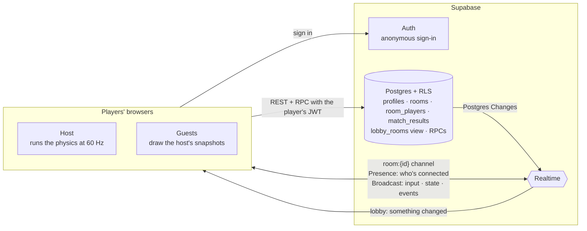
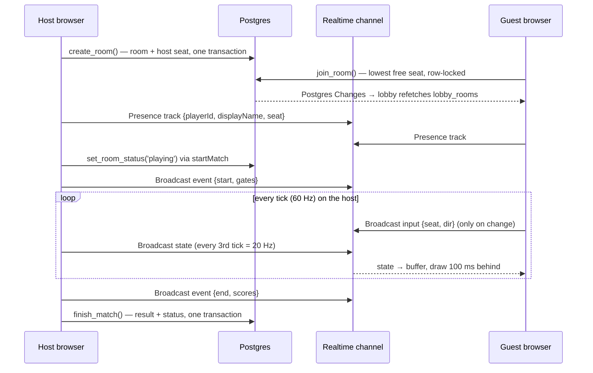

# Arena Pong

Multiplayer Pong on a circular board, built to show what [Supabase](https://supabase.com) can do as the *entire* backend of a real-time game.

Two to eight players each defend a gate on the rim. When the ball gets past your paddle into your gate, every other player scores. There is no game server: browsers talk to Supabase directly, and one player's browser (the room's host) runs the physics.

- **Frontend:** Vite and strict TypeScript, plain DOM and Canvas 2D, no frameworks.
- **Backend:** Supabase Auth (anonymous), Postgres with Row Level Security, RPCs, and Realtime (Postgres Changes, Presence, Broadcast).
- **Runtime dependencies:** just `@supabase/supabase-js`.

## Quick start

You need Node 24+ and a Docker-compatible runtime for the local Supabase stack.  Podman works: enable its socket (`systemctl --user enable --now podman.socket`) and set `DOCKER_HOST=unix://$XDG_RUNTIME_DIR/podman/podman.sock`.

```sh
make install               # npm install; also enables the pre-commit hook
make start                 # local Postgres, Auth, Realtime (first run downloads images)
cp .env.example .env.local # then fill in the URL and anon key from `make status`
make dev                   # http://127.0.0.1:5173
```

`make` on its own lists every target: local stack, builds, tests and deploys.  Each one wraps an `npm` or `npx supabase` command, so those work directly too.  The Makefile sets `DOCKER_HOST` for Podman automatically when Docker isn't installed.

- **Play multiplayer:** open two or more tabs.  Each tab is its own player (sessions live in `sessionStorage`).  Pick a name, create a room in one tab, join from the others, and the host presses Start.  Move with ← → or A D.
- **Practice alone:** open [`/#sandbox`](http://127.0.0.1:5173/#sandbox), or use Practice in the lobby.  It plays you against bots and has sliders for every physics setting.

## How it fits together



What happens over one match:



## Why each Supabase feature

| Need | Supabase feature | Why this one | Where |
|---|---|---|---|
| Know who each player is without a signup form | **Anonymous sign-in** | Every player gets a real `auth.users` row and a JWT, so RLS can use `auth.uid()` exactly as it would for a real account.  An anonymous user can later be linked to email or OAuth without changing their id. | [`src/auth.ts`](src/auth.ts) |
| Public names, private writes | **Postgres + RLS** on `profiles` | `auth.users` isn't exposed through the API.  A plain table with "anyone signed in can read, you can only write your own row" takes a few lines, and other tables can reference it with real foreign keys. | [`profiles.sql`](supabase/migrations/20261023222216_profiles.sql) |
| Rules that live next to the data | **RLS** on `rooms`, `room_players`, `match_results` | The browser talks to the database through the generated API.  The rules for who can create, leave, remove, delete and read live in the database, not in client code that could be bypassed. | [`rooms.sql`](supabase/migrations/20261023225908_rooms.sql) |
| Two players must never get the same seat | **RPC** `join_room` (`security definer`) | Choosing the lowest free seat is a read followed by a write.  From the client, two joins could read the same free seat.  The RPC locks the room row (`for update`), so joins to one room happen one at a time.  An integration test fires 12 joins at an 8-seat room at once. | [`lobby_rpcs.sql`](supabase/migrations/20261023225909_lobby_rpcs.sql) |
| Writes that must happen together, or need checks RLS can't express | **RPCs** `create_room`, `set_room_status`, `finish_match` | `create_room` seats the host in the same transaction, so the lobby never shows an empty room.  RLS can't limit an update to one column or check a status transition, so status changes go through `set_room_status` (host only, forward only).  `finish_match` writes the result and the finished status together, and validates the scores. | same |
| "3/4 players" in the lobby | **View** `lobby_rooms` with `security_invoker` | One round trip for the join and count, queried like a table.  `security_invoker` makes it run with the caller's permissions.  Without it, a view runs as its owner and silently bypasses RLS. | same |
| Lobby updates live | **Realtime Postgres Changes** | Room lists change rarely, so "tell me something changed and I'll refetch" is simple and cheap.  For inserts and updates, Realtime checks RLS before delivering the change.  Deletes always go through, but carry only the key.  The channel uses `postgres_changes_options: { wait: true }`, so the first refetch happens only once changes are flowing.  Without it, changes made just after subscribing could be missed. | [`src/lobby/api.ts`](src/lobby/api.ts) |
| Who is actually connected | **Realtime Presence** | The database knows who holds a seat, not who is online.  Presence is tied to the socket, so a closed tab or a dropped network shows up as a leave, with no heartbeat code of ours. | [`src/room/session.ts`](src/room/session.ts) |
| Game traffic: inputs, snapshots, room events | **Realtime Broadcast** | These only matter to people connected right now, so writing them to a table would be wasted work.  Broadcast sends them straight to the other sockets on the channel. | same, and [`src/game/`](src/game/) |
| Schema you can review, reproduce and test | **Supabase CLI**: migrations, local stack, `supabase test db` (pgTAP), `gen types` | Every schema change is a migration file.  The local stack runs the same Postgres, Auth and Realtime as production.  RLS and RPCs have SQL tests, and `src/database.types.ts` is generated, so queries are type-checked. | [`supabase/`](supabase/) |

Deliberately not used yet:
- **Edge Functions:** nothing needs server-side code, because the host's browser runs the game.
- **Storage:** there are no files.
- **Realtime Authorization (private channels):** see [Known limitations](#known-limitations).

## Netcode

The design is host-authoritative with client-side interpolation.

- **The host** ([`src/game/host.ts`](src/game/host.ts)) runs [`physics.ts`](src/game/physics.ts) at a fixed 60 Hz and applies everyone's inputs.
  - It broadcasts a snapshot every 3rd tick (20 Hz), plus `goal` and `end` events.
  - Its timer runs in a Web Worker, because browsers throttle timers in background tabs and a hidden host tab would otherwise freeze the match.
- **Guests** ([`src/game/client.ts`](src/game/client.ts)) buffer snapshots and draw 100 ms in the past, interpolating between the two snapshots around that moment.
  - Host time is estimated from the least-delayed arrival, so jitter doesn't shake the picture.
  - A guest's own paddle is predicted locally: it moves the moment a key is pressed, and eases to the host's position once the player stops.
- **Physics** is pure and deterministic: no DOM, no clocks, and seeded randomness carried in the state.
  - Collisions are found by solving exactly when the ball crosses the paddle and rim circles, so a fast ball can't skip through a paddle between ticks.

| Broadcast | Direction | Rate | Payload |
|---|---|---|---|
| `input` | guest → host | on change only | `{ seat, dir }`, where `dir` is -1, 0 or 1 |
| `state` | host → guests | 20 Hz | `{ tick, ball: [x, y, vx, vy], paddles[], active[], scores[], respawn, rally }`, numbers rounded to 4 decimals; under 260 bytes of JSON with 8 players |
| `event` | host → all | rare | `start` (gate order), `goal`, `end` (scores), `closed`, `removed` |

Every incoming message is checked by a parser in [`src/types.ts`](src/types.ts) before app code sees it.  Malformed messages are dropped.

**Disconnects:**
- A player missing from Presence for 8 seconds loses their seat, and in a match their gate turns into wall.  The 8 seconds are long enough to survive a page reload.
- The host also polls the room's seats every 2 seconds, to catch seats whose player never connected.
- If the host is missing for 8 seconds, everyone else leaves.  There is no host migration.

## Testing

```sh
npm run check   # everything below; the pre-commit hook runs this
```

| Layer | Tool | What it covers |
|---|---|---|
| Unit (`src/**/*.test.ts`) | Vitest | Physics (including a 20,000-tick determinism and containment test), bots, interpolation, snapshot encoding and buffering, host and client with a fake clock and network, message parsers, Presence logic, standings |
| Database (`supabase/tests/database/`) | pgTAP via `supabase test db` | Every RLS policy, constraint and RPC: who can do what, error codes, status transitions, result validation |
| Integration (`tests/integration/`) | Vitest against the local stack | The app's own modules acting as several players: sign-in, lobby queries, the 12-way join race, live lobby updates, Presence and seat cleanup, and full networked matches where results get recorded |
| Typecheck and schema drift | `tsc`, `supabase gen types` | Strict TypeScript, and generated types matching the local schema |

Integration tests don't use the sign-in endpoint for their players.  They create users with the admin API and sign JWTs with the local stack's secret, which keeps runs under the local anonymous sign-in rate limit.  One test covers the real anonymous sign-in path.

The tests don't cover the DOM screens themselves.  Those were checked during development by driving headless Chrome by hand.

## Known limitations

These are deliberate trade-offs for a prototype.  Each one is noted where it lives in the code.

- **The host is trusted.** It runs the physics, so it could cheat, and if it leaves, the match ends.
- **Room channels are public.** Anyone who knows a room id can join `room:{id}` and broadcast fake `start`, `closed` or `state` messages.  A guest's `input` claims a seat number nobody checks.  Messages are checked for shape, not for sender.
- **You see your paddle "now" and the ball 100 ms ago.** On a slow connection, a save that looked like a hit on your screen can be a goal on the host.  That's the usual price of interpolating everything except your own paddle.
- **Launches are aimed at gates.** An early version launched in any direction.  A launch into a wall travels along a diameter, and a plain bounce keeps it there.  With an even number of gates every wall faces another wall, so about 40% of launches with 2 or 4 gates bounced out of everyone's reach forever.  Launches now aim at a random point inside a random active gate, so each one reaches a player in about 1.6 s.  Wall bounces also add a small random turn (±5°), so later rallies can't settle on a diameter either.
- **Cleanup happens in browsers.**
  - Seat removal is the host's job.
  - Waiting rooms whose host vanished stay in the database, hidden from the lobby after an hour.
  - Finished rooms and their seats are never deleted.
- **Anonymous sign-in is open.** On a public deployment, add CAPTCHA (Supabase supports Turnstile and hCaptcha) and keep the rate limits.  The local config raises the per-IP anonymous limit to 100 an hour for testing.
- **Players are anonymous.** Clearing the tab's storage means a new identity.  Accounts would come from linking anonymous users to email or OAuth.

## What changes at scale

- **Authority moves to a server.** A dedicated game process (a small Node or Go service, or a managed game server) would run the physics.  Supabase would keep handling identity, rooms, results and the lobby, and could keep carrying the traffic over Broadcast.  Edge Functions aren't a fit for a 60 Hz loop that lasts minutes.
- **Private channels.** [Realtime Authorization](https://supabase.com/docs/guides/realtime/authorization) puts RLS on `realtime.messages`, so only seated players can join `room:{id}` and only the host can send `state` and `event`.  Inputs would be tied to the sender instead of a claimed seat.
- **Server-side housekeeping.** `pg_cron` jobs would close abandoned rooms, delete old seats and finish matches whose host disappeared, instead of relying on a browser being open.
- **The lobby scales differently.** Every lobby client refetching on every room change is fine for dozens of rooms.  For thousands, you'd want:
  - lobby updates broadcast from a database trigger (`realtime.broadcast_changes`) carrying the changed row;
  - pagination and filters;
  - possibly a separate "open rooms" table.
- **Message budget.** Each match sends 20 snapshots a second to every guest, plus inputs.  Realtime quotas count messages, so cost grows with matches × players.  Lower snapshot rates, sending only what changed, or binary payloads are the next levers.
- **Results become features.** `match_results` already keys scores by player id, so leaderboards and per-player history are views on top of it.

## Deploying

The backend goes to a hosted Supabase project.  The frontend is static files (`dist/`), deployed here to [Cloudflare Pages](https://pages.cloudflare.com).  Any static host works the same way.

### 1. Supabase project (once)

1. Create a project at [supabase.com/dashboard](https://supabase.com/dashboard), and note its **project ref** (in the project's general settings, and in its URL) and its database password.
2. Log in and link this repo, then check what will be applied:

   ```sh
   npx supabase login
   make supabase-link SUPABASE_PROJECT_REF=<ref>
   make db-diff   # lists the migrations db-push would apply
   ```

3. Turn on **anonymous sign-ins** in the dashboard's Auth settings.  Do it there rather than with `supabase config push`, because `supabase/config.toml` contains local-only settings: the `127.0.0.1` site URL, the raised anonymous rate limit, and analytics turned off for Podman.
4. Copy the project URL and anon (publishable) key from the project's API settings.  You'll need them for the frontend.

### 2. Migrations (every schema change)

```sh
make db-push   # applies new migrations to the linked project
```

### 3. Frontend on Cloudflare Pages

Vite bakes `VITE_SUPABASE_URL` and `VITE_SUPABASE_ANON_KEY` into the bundle at **build time**, so they have to be present wherever the build runs.

**Option A: Cloudflare builds from Git (recommended).** In the Cloudflare dashboard, go to Workers & Pages → Create → Pages → Connect to Git, pick this repository, and set:

| Setting | Value |
|---|---|
| Framework preset | None (or Vite) |
| Build command | `npm run build` |
| Build output directory | `dist` |
| Production branch | `main` |
| Environment variables (Production and Preview) | `VITE_SUPABASE_URL`, `VITE_SUPABASE_ANON_KEY` |

The build uses Node 24 from [`.node-version`](.node-version).  Every push to `main` deploys to production, and other branches get preview URLs.  The `prepare` script that sets up the git hook also runs during `npm install` there, which is harmless.

**Option B: build locally and upload with Wrangler.**

```sh
# Hosted values; .env.*.local files are git-ignored.
cat > .env.production.local <<'ENV'
VITE_SUPABASE_URL=https://<ref>.supabase.co
VITE_SUPABASE_ANON_KEY=<anon key>
ENV

npx wrangler@4.149.0 login                # once; or set CLOUDFLARE_API_TOKEN
make pages-create CF_PAGES_PROJECT=<name> # once
make deploy-web CF_PAGES_PROJECT=<name>   # build, check, upload
```

`make deploy-web` refuses to deploy if `.env.production.local` is missing, or if the built files still point at `127.0.0.1:54321`.  Without that file, `npm run build` would quietly use `.env.local` and ship a site that talks to your laptop.  `make deploy` runs `db-push` and then `deploy-web`.

### 4. After the first deploy

- **Site URL:** set the Pages URL (for example `https://<name>.pages.dev`) as the **Site URL** in Supabase's Auth URL configuration.  Anonymous sign-in doesn't redirect, so nothing breaks without it today, but email or OAuth sign-in will need it.
- **Routing:** none needed.  The app only uses `/` and `/#sandbox`, so Pages needs no single-page-app fallback rules.
- **Before sharing the link:** turn on CAPTCHA for sign-ins.  Cloudflare Turnstile fits naturally here: create a Turnstile widget for the Pages domain, then turn on CAPTCHA protection in Supabase's Auth settings with Turnstile as the provider and the widget's secret key.  **The app doesn't send a CAPTCHA token yet**, so turning this on today blocks sign-in.  The frontend needs to render the Turnstile widget and pass its token as `options.captchaToken` to `signInAnonymously()` in [`src/auth.ts`](src/auth.ts).
- **Tests stay local.** Never point the integration tests at a hosted project.  They sign tokens with the local stack's secret, and create and delete users.

## Project layout

```
src/
  main.ts              screen routing
  supabase.ts, auth.ts client and anonymous sign-in
  lobby/               room list, create/join (Postgres Changes)
  room/                RoomSession (Presence + Broadcast), waiting room, match and results screens
  game/                physics, host, client, snapshots, renderer, sandbox
  types.ts             shared types and message parsers
supabase/
  migrations/          schema, RLS, RPCs
  tests/database/      pgTAP
tests/integration/     app modules against the local stack
scripts/check.sh       what `npm run check` and the pre-commit hook run
Makefile               shortcuts for the stack, builds, tests and deploys (`make` lists them)
```

[`CLAUDE.md`](CLAUDE.md) holds the full spec and conventions.
