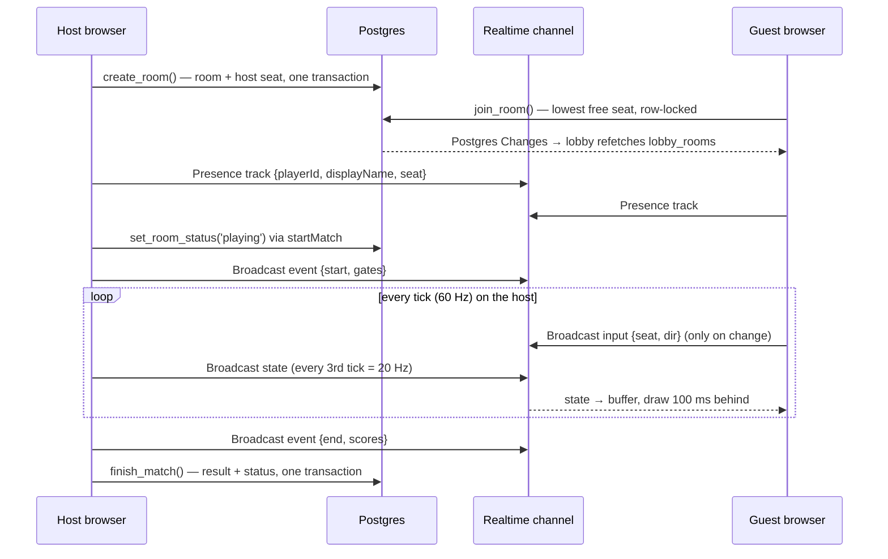

# Arena Pong

Multiplayer Pong on a circular board, built to show what [Supabase](https://supabase.com) can do as the *entire* backend of a real-time game.

Two to eight players each defend a gate on the rim. When the ball gets past your paddle into your gate, the last player to touch it scores. There is no game server: browsers talk to Supabase directly, and one player's browser (the room's host) runs the physics.

- **Frontend:** Vite and strict TypeScript, plain DOM and Canvas 2D, no frameworks.
- **Backend:** Supabase Auth (anonymous), Postgres with Row Level Security, RPCs, and Realtime (Postgres Changes, Presence, Broadcast).
- **Runtime dependencies:** just `@supabase/supabase-js`.

## Quick start

You need Node 24+ and a Docker-compatible runtime for the local Supabase stack.  Podman works: enable its socket (`systemctl --user enable --now podman.socket`) and set `DOCKER_HOST=unix://$XDG_RUNTIME_DIR/podman/podman.sock`.

```sh
make install               # npm install; also enables the pre-commit hook
make start                 # local Postgres, Auth, Realtime (first run downloads images)
cp .env.example .env.local # then fill in the URL and anon key from `make status`
make dev                   # http://127.0.0.1:5173
```

`make` on its own lists every target: local stack, builds, tests and deploys.  Each one wraps an `npm` or `npx supabase` command, so those work directly too.  The Makefile sets `DOCKER_HOST` for Podman automatically when Docker isn't installed.

- **Play multiplayer:** open two or more tabs.  Each tab is its own player (sessions live in `sessionStorage`).  Pick a name, create a room in one tab, join from the others, and the host presses Start.  The host can fill empty seats with bots first.  Move with ← → or A D.  On a phone or tablet, hold the ◀ ▶ buttons under the board instead (add `?touch=1` to the URL to try them on a desktop).
- **Practice alone:** open [`/#sandbox`](http://127.0.0.1:5173/#sandbox), or use Practice in the lobby.  It plays you against bots and has sliders for every physics setting.

## How it fits together


What happens over one match:



## Why each Supabase feature

| Need | Supabase feature | Why this one | Where |
|---|---|---|---|
| Know who each player is without a signup form | **Anonymous sign-in** | Every player gets a real `auth.users` row and a JWT, so RLS can use `auth.uid()` exactly as it would for a real account.  An anonymous user can later be linked to email or OAuth without changing their id. | [`src/auth.ts`](src/auth.ts) |
| Keep scripts from minting users | **Auth CAPTCHA** (Cloudflare Turnstile) | Supabase verifies the token on sign-in itself, so bot protection needs no backend code.  Turnstile is usually invisible, and the site is already on Cloudflare.  The local stack uses Cloudflare's always-pass test keys, so the same code path runs in dev. | [`src/captcha.ts`](src/captcha.ts) |
| Public names, private writes | **Postgres + RLS** on `profiles` | `auth.users` isn't exposed through the API.  A plain table with "anyone signed in can read, you can only write your own row" takes a few lines, and other tables can reference it with real foreign keys. | [`profiles.sql`](supabase/migrations/20261023222216_profiles.sql) |
| Rules that live next to the data | **RLS** on `rooms`, `room_players`, `match_results` | The browser talks to the database through the generated API.  The rules for who can create, leave, remove, delete and read live in the database, not in client code that could be bypassed. | [`rooms.sql`](supabase/migrations/20261023225908_rooms.sql) |
| Two players must never get the same seat | **RPC** `join_room` (`security definer`) | Choosing the lowest free seat is a read followed by a write.  From the client, two joins could read the same free seat.  The RPC locks the room row (`for update`), so joins to one room happen one at a time.  An integration test fires 12 joins at an 8-seat room at once. | [`lobby_rpcs.sql`](supabase/migrations/20261023225909_lobby_rpcs.sql) |
| Writes that must happen together, or need checks RLS can't express | **RPCs** `create_room`, `set_room_status`, `finish_match` | `create_room` seats the host in the same transaction, so the lobby never shows an empty room.  RLS can't limit an update to one column or check a status transition, so status changes go through `set_room_status` (host only, forward only).  `finish_match` writes the result and the finished status together, and validates the scores. | same |
| "3/4 players" in the lobby | **View** `lobby_rooms` with `security_invoker` | One round trip for the join and count, queried like a table.  `security_invoker` makes it run with the caller's permissions.  Without it, a view runs as its owner and silently bypasses RLS. | same |
| Leaderboard and match history | **Views** `match_players` and `leaderboard` (`security_invoker`) | Scores are stored as one jsonb object per match, the right shape for writing a result in one go.  `match_players` unpacks it into one row per player per match and ranks each match with `rank()`; `leaderboard` totals that per player.  The client queries both like tables, with no stats code of its own.  `finish_match` copies the room and player names into the result, so history still reads right after cleanup deletes the room and the players. | [`match_stats.sql`](supabase/migrations/20261024030000_match_stats.sql) |
| Lobby updates live | **Realtime Postgres Changes** | Room lists change rarely, so "tell me something changed and I'll refetch" is simple and cheap.  For inserts and updates, Realtime checks RLS before delivering the change.  Deletes always go through, but carry only the key.  The channel uses `postgres_changes_options: { wait: true }`, so the first refetch happens only once changes are flowing.  Without it, changes made just after subscribing could be missed. | [`src/lobby/api.ts`](src/lobby/api.ts) |
| Who is actually connected | **Realtime Presence** | The database knows who holds a seat, not who is online.  Presence is tied to the socket, so a closed tab or a dropped network shows up as a leave, with no heartbeat code of ours. | [`src/room/session.ts`](src/room/session.ts) |
| Game traffic: inputs, snapshots, room events | **Realtime Broadcast** | These only matter to people connected right now, so writing them to a table would be wasted work.  Broadcast sends them straight to the other sockets on the channel. | same, and [`src/game/`](src/game/) |
| Only seated players in a room's channels, only the host sends game state | **Realtime Authorization** (private channels) | RLS policies on `realtime.messages` are checked when a client joins, against the same `room_players` and `rooms` tables as everything else.  Policies can tell broadcast from presence but not one event from another, so traffic is split by sender: on `room:{id}` only the host may broadcast, and inputs go on `room:{id}:input`.  The lobby channel is private too (read only), so the project refuses public channels altogether. | [`private_room_channels.sql`](supabase/migrations/20261024020243_private_room_channels.sql) |
| Tidy up without a server | **pg_cron** | Abandoned rooms and throwaway anonymous users would otherwise pile up, since in-game cleanup depends on a host's browser.  A scheduled SQL function inside Postgres runs every 15 minutes: rooms older than 2 hours go (seats with them, results stay), and so do anonymous users idle for 7 days.  No Edge Function, no external scheduler. | [`cleanup_job.sql`](supabase/migrations/20261024022239_cleanup_job.sql) |
| Schema you can review, reproduce and test | **Supabase CLI**: migrations, local stack, `supabase test db` (pgTAP), `gen types` | Every schema change is a migration file.  The local stack runs the same Postgres, Auth and Realtime as production.  RLS and RPCs have SQL tests, and `src/database.types.ts` is generated, so queries are type-checked. | [`supabase/`](supabase/) |

Deliberately not used yet:
- **Edge Functions:** nothing needs server-side code, because the host's browser runs the game.
- **Storage:** there are no files.

## Netcode

The design is host-authoritative with client-side interpolation.

- **The host** ([`src/game/host.ts`](src/game/host.ts)) runs [`physics.ts`](src/game/physics.ts) at a fixed 60 Hz and applies everyone's inputs.
  - It broadcasts a snapshot every 3rd tick (20 Hz), plus `goal` and `end` events.
  - Its timer runs in a Web Worker, because browsers throttle timers in background tabs and a hidden host tab would otherwise freeze the match.
- **Guests** ([`src/game/client.ts`](src/game/client.ts)) buffer snapshots and draw 100 ms in the past.  Between two snapshots they replay the physics from the earlier one, since the ball can cover several ball widths between snapshots and a straight line would cut the corner at every bounce.
  - Host time is estimated from the least-delayed arrival, and the drawing clock eases toward that estimate (at most 5% fast or slow) instead of jumping, so jitter doesn't shake the picture.
  - If a snapshot is late, the physics runs on from the newest one for up to 150 ms, instead of the picture freezing and then jumping when it arrives.
  - A guest's own paddle is predicted locally: it moves the moment a key is pressed.  Inputs carry the paddle's position, and the host adopts it, so the host's copy stops where the player stopped.
- **Saves the guest saw** ([`src/game/saves.ts`](src/game/saves.ts)).  A guest sees the ball ~100 ms late but their own paddle now, so a save on their screen can be a miss on the host.
  - The guest's client spots this (the ball reached their paddle on screen, and the host's ball didn't bounce) and sends a save claim with the tick and paddle position.
  - The host keeps the last 250 ms of ticks.  If the claim is recent, comes from that gate's player, is within 0.4 s of paddle travel of where the host had it, and turns out to be a hit when replayed, the host rewinds to that tick and replays to the present with the guest's paddle.  The physics is pure, so a rewind is a few dozen steps.
  - So a late save can still cancel a goal, goals against a guest become official (scored, flashed, counted toward the end) only after that 250 ms.  Goals against the host or a bot are official at once.
  - The guest draws its own claim straight away, replaying the save locally until the host's corrected snapshots reach the screen.  Otherwise the snapshots already on their way would show the goal first.
- **Physics** is pure and deterministic: no DOM, no clocks, and seeded randomness carried in the state.
  - Collisions are found by solving exactly when the ball crosses the paddle and rim circles, so a fast ball can't skip through a paddle between ticks.

| Broadcast | Direction | Rate | Payload |
|---|---|---|---|
| `input` | guest → host, on `room:{id}:input` | on change, and 5 Hz while moving | `{ seat, dir, paddle }`, where `dir` is -1, 0 or 1 and `paddle` is the guest's paddle angle |
| `state` | host → guests | 20 Hz | `{ tick, ball: [x, y, vx, vy], paddles[], active[], scores[], goals, touch, seed, respawn, rally }`, numbers rounded to 4 decimals; under 300 bytes of JSON with 8 players |
| `event` | host → all | rare | `start` (gate order), `goal`, `end` (scores), `closed`, `removed` |

Every incoming message is checked by a parser in [`src/types.ts`](src/types.ts) before app code sees it.  Malformed messages are dropped.

**Disconnects:**
- A player missing from Presence for 8 seconds loses their seat, and in a match their gate turns into wall.  The 8 seconds are long enough to survive a page reload.
- The host also polls the room's seats every 2 seconds, to catch seats whose player never connected.
- If the host is missing for 8 seconds, everyone else leaves.  There is no host migration.

## Testing

```sh
npm run check   # everything below; the pre-commit hook runs this
```

| Layer | Tool | What it covers |
|---|---|---|
| Unit (`src/**/*.test.ts`) | Vitest | Physics (including a 20,000-tick determinism and containment test), bots, interpolation, snapshot encoding and buffering, host and client with a fake clock and network, message parsers, Presence logic, standings |
| Database (`supabase/tests/database/`) | pgTAP via `supabase test db` | Every RLS policy (tables and private channels), table grants, constraints and RPCs: who can do what, error codes, status transitions, result validation, and the cleanup job |
| Integration (`tests/integration/`) | Vitest against the local stack | The app's own modules acting as several players: sign-in, lobby queries, the 12-way join race, live lobby updates, Presence and seat cleanup, and full networked matches where results get recorded |
| Typecheck and schema drift | `tsc`, `supabase gen types` | Strict TypeScript, and generated types matching the local schema |

Integration tests don't use the sign-in endpoint for their players.  They create users with the admin API and sign JWTs with the local stack's secret, which keeps runs under the local anonymous sign-in rate limit.  One test covers the real anonymous sign-in path.

The tests don't cover the DOM screens themselves.  Those were checked during development by driving headless Chrome by hand.

## Known limitations

These are deliberate trade-offs for a prototype.  Each one is noted where it lives in the code.

- **The host is trusted.** It runs the physics, so it could cheat, and if it leaves, the match ends.
- **Seated players can spoof each other's inputs.** Room channels are private: outsiders can't join, and only the host can broadcast state and events.  But a Broadcast message doesn't carry its sender, so a guest's `input` claims a seat number the host can't verify.  A seated player could move someone else's paddle.
- **Channel access is checked at join.** Realtime caches it for the connection, so a player whose seat is removed keeps receiving room messages until their socket rejoins.
- **Guests decide their own saves.** A guest's claim is checked for plausibility, not proof, so a modified client could claim saves it didn't make.  That's the anti-cheat non-goal again.
- **A late save looks like a jump to everyone else.** When the host accepts a claim, the host and other guests see the ball, already past the paddle or gone, come back on its bounce.  The guest who made the save sees it as it happened.
- **Slow connections lose the benefit.** A claim has to reach the host within 250 ms of the moment, which covers the 100 ms drawing delay plus a round trip of about 130 ms.  Beyond that, claims are refused and the host's call stands.
- **Launches are aimed at gates.** An early version launched in any direction.  A launch into a wall travels along a diameter, and a plain bounce keeps it there.  With an even number of gates every wall faces another wall, so about 40% of launches with 2 or 4 gates bounced out of everyone's reach forever.  Launches now aim at a random point inside a random active gate, so each one reaches a player in about 1.6 s.  Wall bounces also add a small random turn (±5°), so later rallies can't settle on a diameter either.
- **Live cleanup happens in browsers.** Removing a disconnected player's seat is the host's job, and a match whose host vanished just stops.  The `pg_cron` job is the backstop: it deletes any room older than 2 hours, and anonymous users idle for 7 days.  A deleted player's id stays in old `match_results.scores`, with no name to go with it.
- **Anonymous sign-in is behind a CAPTCHA, and that's all.** Turnstile stops scripted sign-ups, and Supabase's per-IP rate limit backs it up.  The local config raises that limit to 100 an hour for testing.
- **Players are anonymous.** Clearing the tab's storage means a new identity.  Accounts would come from linking anonymous users to email or OAuth.

## What changes at scale

- **Authority moves to a server.** A dedicated game process (a small Node or Go service, or a managed game server) would run the physics.  Supabase would keep handling identity, rooms, results and the lobby, and could keep carrying the traffic over Broadcast.  Edge Functions aren't a fit for a 60 Hz loop that lasts minutes.
- **Inputs tied to their sender.** With a game server, each player's input would arrive over their own authenticated connection, instead of claiming a seat on a shared channel.
- **Faster housekeeping.** The cleanup job's 2-hour cutoff is fine at this size.  With a server running matches, abandoned rooms could be closed the moment their host disappears instead.
- **The lobby scales differently.** Every lobby client refetching on every room change is fine for dozens of rooms.  For thousands, you'd want:
  - lobby updates broadcast from a database trigger (`realtime.broadcast_changes`) carrying the changed row;
  - pagination and filters;
  - possibly a separate "open rooms" table.
- **Message budget.** Each match sends 20 snapshots a second to every guest, plus inputs.  Realtime quotas count messages, so cost grows with matches × players.  Lower snapshot rates, sending only what changed, or binary payloads are the next levers.
- **Stats get stored, not recomputed.** The `leaderboard` and `match_players` views recompute from every result on each read.  With many results, a trigger on `match_results` would keep a per-player stats table up to date instead, and history would page by `finished_at`.

## Deploying

The backend goes to a hosted Supabase project.  The frontend is static files (`dist/`), deployed here to [Cloudflare Pages](https://pages.cloudflare.com).  Any static host works the same way.

### 1. Supabase project (once)

1. Create a project at [supabase.com/dashboard](https://supabase.com/dashboard), and note its **project ref** (in the project's general settings, and in its URL) and its database password.
2. Log in and link this repo, then check what will be applied:

   ```sh
   npx supabase login
   make supabase-link SUPABASE_PROJECT_REF=<ref>
   make db-diff   # lists the migrations db-push would apply
   ```

3. Turn on **anonymous sign-ins** in the dashboard's Auth settings, and turn off **Allow public access** in the Realtime settings, since every channel the app uses is private.  Do it there rather than with `supabase config push`, because `supabase/config.toml` contains local-only settings: the `127.0.0.1` site URL, the raised anonymous rate limit, and analytics turned off for Podman.
4. Copy the project URL and anon (publishable) key from the project's API settings.  You'll need them for the frontend.

### 2. Migrations (every schema change)

CI applies new migrations on every push to `main`, just before it deploys the frontend (see below).  Each migration has to work with the frontend that's already live, since that frontend keeps running until the deploy finishes, or longer if the deploy fails.  Add tables, columns and views freely.  To rename or drop something the frontend uses, ship code that no longer needs it first, and remove it in a later migration.

To apply migrations by hand, for example if CI is down:

```sh
make db-diff   # lists the migrations db-push would apply
make db-push   # applies them to the linked project
```

### 3. Frontend on Cloudflare Pages, deployed by CI

Vite bakes `VITE_SUPABASE_URL`, `VITE_SUPABASE_ANON_KEY` (the publishable key) and `VITE_TURNSTILE_SITE_KEY` into the bundle at **build time**, so they have to be present wherever the build runs.

[`.github/workflows/ci.yml`](.github/workflows/ci.yml) runs `npm run check` against a fresh local Supabase stack on every push and pull request.  On `main`, if the checks pass, a `migrate` job runs `make db-push` to apply new migrations to the hosted database.  Then a `deploy` job runs `make deploy-web` to build with the hosted values and upload `dist/` to Pages.  If a migration fails, nothing is deployed, and a failed deploy can be re-run on its own.  Runs on `main` queue rather than overlap, so two pushes never apply migrations at once.  Pages' own Git builds are turned off, so a commit that fails the checks never reaches production.

One-time setup:

1. **Pages project.** Create it through Workers & Pages → Create → Pages (the Pages option may be a small link at the bottom of the Create screen) → Connect to Git, or with `make pages-create`.  If it's Git-connected, open the project's **Settings → Build → Branch control**, turn off **automatic production branch deployments**, and set preview branches to **None**.  Otherwise Pages would deploy every push itself, checks or not.
2. **Cloudflare API token.** Under My Profile → API Tokens, create a custom token with the **Account → Cloudflare Pages → Edit** permission.  Your **account ID** is on the Workers & Pages overview.
3. **GitHub.** In the repository's Settings → Environments, create an environment named `production` and add:
   - secrets `CLOUDFLARE_API_TOKEN` and `CLOUDFLARE_ACCOUNT_ID`;
   - secret `SUPABASE_ACCESS_TOKEN`, for applying migrations: a scoped Supabase access token (Account → Access Tokens) with **Database: read-write** (`database_write`, which the CLI needs to create its temporary login role) and **Connection Pooling: read** (`database_pooling_config_read`).  GitHub's runners have no IPv6 and the database's direct host is IPv6-only, so the CLI has to look up the IPv4 pooler.  Without that permission it fails with "IPv6 is not supported on your current network".  The Migrations permission isn't needed: the CLI applies migrations over the database connection;
   - variables `VITE_SUPABASE_URL`, `VITE_SUPABASE_ANON_KEY`, `VITE_TURNSTILE_SITE_KEY` and `SUPABASE_PROJECT_REF`.

The workflow deploys to the Pages project named by `CF_PAGES_PROJECT` in the [`Makefile`](Makefile).

**Deploying from your machine** works too, for example if CI is down:

```sh
# Hosted values; .env.*.local files are git-ignored.
cat > .env.production.local <<'ENV'
VITE_SUPABASE_URL=https://<ref>.supabase.co
VITE_SUPABASE_ANON_KEY=<anon key>
VITE_TURNSTILE_SITE_KEY=<Turnstile site key>
ENV

npx wrangler@4.149.0 login   # once; or set CLOUDFLARE_API_TOKEN
make deploy-web              # build, check, upload
```

`make deploy-web` refuses to deploy without the hosted values (from the environment or `.env.production.local`) or without a Turnstile site key, and refuses a build that still points at `127.0.0.1:54321` or uses Turnstile's test key.  Without those values, `npm run build` would quietly use `.env.local` and ship a site that talks to your laptop.  `make deploy` runs `db-push` and then `deploy-web`.

### 4. After the first deploy

- **Site URL:** set the Pages URL (for example `https://<name>.pages.dev`) as the **Site URL** in Supabase's Auth URL configuration.  Anonymous sign-in doesn't redirect, so nothing breaks without it today, but email or OAuth sign-in will need it.
- **Routing:** none needed.  The app only uses `/` and `/#sandbox`, so Pages needs no single-page-app fallback rules.
- **CAPTCHA:** in Cloudflare, add a **Turnstile** widget for the Pages hostname (managed mode).  Put its **site key** in the frontend as `VITE_TURNSTILE_SITE_KEY` and redeploy.  Then, in Supabase's Auth **Attack Protection** settings, turn on CAPTCHA with Turnstile as the provider and the widget's **secret key**.  Do it in that order: Supabase ignores tokens while CAPTCHA is off, but once it's on, a frontend without the site key can't sign anyone in.
- **Tests stay local.** Never point the integration tests at a hosted project.  They sign tokens with the local stack's secret, and create and delete users.

## Project layout

```
src/
  main.ts              screen routing
  supabase.ts, auth.ts client and anonymous sign-in
  lobby/               room list, create/join (Postgres Changes)
  stats/               leaderboard and match history
  room/                RoomSession (Presence + Broadcast), waiting room, match and results screens
  game/                physics, host, client, snapshots, renderer, sandbox
  types.ts             shared types and message parsers
supabase/
  migrations/          schema, RLS, RPCs
  tests/database/      pgTAP
tests/integration/     app modules against the local stack
scripts/check.sh       what `npm run check` and the pre-commit hook run
Makefile               shortcuts for the stack, builds, tests and deploys (`make` lists them)
```


[`CLAUDE.md`](CLAUDE.md) holds the full spec and conventions.
